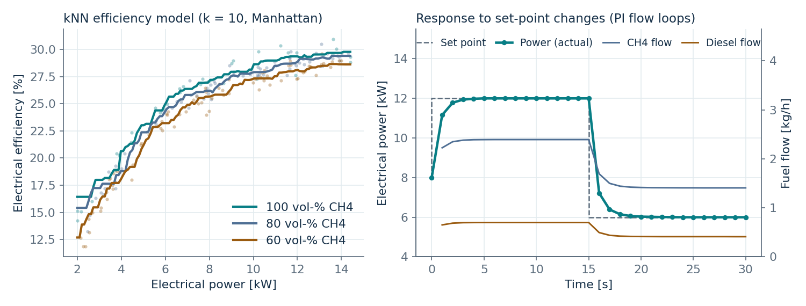
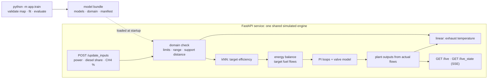

# Dual-Fuel Engine Digital Twin

A simulation and inference-service prototype for a diesel/biogas generator set: two small regression models and an energy balance set the targets, PI loops drive simulated fuel valves, and a FastAPI service exposes one shared simulated engine.

[](.github/workflows/ci.yml)
[](#4-quick-start)
[](https://fastapi.tiangolo.com/)
[](LICENSE)
[](https://kivanho.github.io/#twin)

<picture>
  <source media="(prefers-color-scheme: dark)" srcset="docs/twin_overview_dark.png">
  
</picture>

<sub>Both panels come from the synthetic engine map and the bundle trained on it (`python -m app.train && python -m scripts.make_figures`), not from laboratory data.</sub>

## 1. The engineering question

Given a requested operating point of a dual-fuel genset (electrical power, diesel energy share, methane content of the biogas), what fuel flows does the engine need, and how do power, exhaust temperature, current and torque evolve while the fuel valves move there? The twin answers this for a 2.2 L, 1500 rpm diesel genset (16.5 kVA / 13.2 kWe prime, 18 kVA / 14.4 kWe standby) converted to dual-fuel operation, so that a control strategy or a dashboard can be developed against it without the test bench.

## 2. What this repository implements

- **Steady-state models.** Electrical efficiency: k-nearest neighbours (k = 10, Manhattan distance, standardised power and CH4 share). Exhaust temperature: linear regression on power, CH4 share and diesel energy share.
- **Energy balance.** Fuel energy Q = P / η, split by diesel energy share, divided by the lower heating values (diesel 42.7 MJ/kg, CH4 50.03 MJ/kg) gives the target mass flows.
- **Plant and control simulation.** One PI controller per fuel line on a first-order valve (T = 2 s), gains chosen for a 0.8 s closed-loop time constant, command clamped to the valve range, integrator frozen while saturated. Power, diesel energy share, exhaust temperature, current and torque are derived from the *actual* flows; power is limited to the 14.4 kWe rating.
- **Training command** (`python -m app.train`) that validates the engine map, fits both models, evaluates them against baselines and held-out regions, and writes a **versioned model bundle** (models with preprocessing, feature order and units, supported operating domain, config and seed, data fingerprint, evaluation, dependency versions, git commit, checksums).
- **Service** (`app/main.py`) that loads a bundle at startup, never trains, and runs **one simulated engine shared by all clients**, stepped once per simulated second by a background task. Endpoints set the operating point, read or stream the state, stop/start/reset the simulation, and report health, readiness and the loaded model.
- **Operating-point policy.** Requests are checked against the genset's equipment limits *and* the bundle's supported domain (training range plus a support-distance check). Unsupported points are rejected with HTTP 422 by default, or accepted with a `warnings` field when `UNSUPPORTED_POINT_POLICY=warn`.



This is a prototype of a simulation and inference service, not a production deployment. Simulation performance does not establish real-engine performance, modelled fuel flows are not measured ones, and nothing here is a certified control for a physical engine.

## 3. Data provenance and the public/private boundary

The original project (master's project, IMT Atlantique, Feb-Jun 2025, team of three; I led the project and did the main implementation) trained on laboratory measurements from the test bench. Those measurements are **not public** and are not in this repository; the original repository stays private because of them.

This repository ships a **synthetic engine map** (`app/synthetic_data.py`): 400 steady-state points with the same columns, made of the 8 corners of the design range (2-14.4 kW, 55-100 vol-% CH4, 10-60 % diesel energy share) and 392 uniformly sampled points. Efficiency rises with load and saturates, CO2 dilution lowers efficiency and exhaust temperature, more pilot diesel helps at low load. At 100 % CH4 and 30 % diesel energy share the curves are anchored to the diesel-only datasheet (efficiency within 1 percentage point at 50/75/100 % load). Treating the dual-fuel engine like the diesel original at that point is an assumption; the dual-fuel effects on top are illustrative formulas with Gaussian noise, not measurements. The synthetic map has no measurement sessions, instruments or groups; it comes from a seed.

Every number in section 5 is computed on this synthetic map and is an **implementation check**, not evidence about the real engine. In particular the synthetic exhaust temperature is a near-linear formula, so a linear model scoring R² 0.99 on it is expected and says nothing about engines.

To train on your own measurements: `python -m app.train --csv my_map.csv --out models/my_engine`. The expected columns, units and physical ranges are documented in `app/engine_map.py`; a file that fails validation is rejected with a message saying what to fix (non-numeric values, missing values, unit mistakes, duplicates, too few rows for the split and the kNN).

## 4. Quick start

Python 3.11 or 3.12. The bundle is not committed; training it takes a few seconds.

```bash
python3 -m venv .venv && source .venv/bin/activate
pip install -r requirements-dev.txt          # pinned; requirements.txt alone is enough to serve

python -m app.train                          # 1. train the synthetic bundle -> models/synthetic
uvicorn app.main:app --workers 1             # 2. serve on http://localhost:8000 (API docs at /docs)
```

In a second shell:

```bash
curl localhost:8000/ready                    # {"ready": true, "model_version": "synthetic-...-8ae52956"}
curl -X POST localhost:8000/update_inputs -H "Content-Type: application/json" \
     -d '{"power_output": 12, "diesel_energy_share": 20, "methane_percentage": 80}'
sleep 10
curl localhost:8000/live                     # snapshot below
curl -N "localhost:8000/live_state?max_events=5"   # the same as Server-Sent Events
curl -X POST localhost:8000/stop             # valves close, engine winds down, stays stopped
curl -X POST localhost:8000/start            # resumes towards the kept operating point
curl -X POST localhost:8000/reset            # t = 0, valves closed, back to 5 kW / 10 % / 85 vol-%
```

Snapshot ten seconds after the request (actual output of the commands above):

```json
{
  "time_s": 11.0, "status": "running", "model_version": "synthetic-20261030T100101Z-8ae52956",
  "input": {"power": 12.0, "des_percent": 20.0, "ch4_percent": 80.0},
  "input_support": {"supported": true, "within_equipment_limits": true, "within_training_box": true,
                    "support_distance": 0.9878, "support_threshold": 1.2688, "violations": []},
  "warnings": [],
  "target": {"efficiency": 0.289, "diesel_mass_flow_kg_h": 0.701, "ch4_mass_flow_kg_h": 2.394, "exhaust_temp": 319.9},
  "actual": {"power": 12.0, "diesel_mass_flow_kg_h": 0.701, "ch4_mass_flow_kg_h": 2.393, "diesel_energy_share": 20.0,
             "co2_in_fuel_gas_kg_h": 1.642, "exhaust_temp": 319.9, "current": 21.6, "torque": 95.5,
             "within_training_domain": true}
}
```

An unsupported request, e.g. 1 kW, is answered with 422 and the reason: `power_output=1 outside the training range [2, 14.4] kW`. A point inside the range but in a sparse part of the map (the extreme corner 14.4 kW / 100 vol-% / 60 %, which is itself a training point) is refused as `sparse region of the training data (support distance 1.923 > 1.269)`.

Docker does the same; the bundle is trained in the image:

```bash
docker build -t dual-fuel-twin . && docker run --rm -p 8000:8000 dual-fuel-twin
```

### API

| Endpoint | Purpose |
|---|---|
| `GET /health` | liveness, loaded model version, simulation status, policy, supported worker count (1) |
| `GET /ready` | 200 once the bundle is loaded, else 503 |
| `GET /model` | the bundle manifest: features, units, supported domain, config, data fingerprint, evaluation |
| `POST /update_inputs` | set the operating point; 422 with the violations if unsupported (`reject` policy) |
| `GET /live`, `GET /live_state` | one consistent snapshot; the same as SSE, one event per step |
| `POST /stop`, `POST /start` | close both valves and wind down / resume towards the kept operating point |
| `POST /reset` | restart at the initial condition: t = 0, valves closed, 5 kW / 10 % DES / 85 vol-% CH4, running |

Environment: `MODEL_BUNDLE_DIR` (default `models/synthetic`), `UNSUPPORTED_POINT_POLICY` (`reject` default, or `warn`), `SIM_BACKGROUND_LOOP` (`1` default; `0` steps only on demand, used by tests).

## 5. Evidence

All on the synthetic map (400 points, seed 42, data fingerprint `8ae52956`), produced by `python -m app.train --out models/synthetic --report-dir docs`; the full tables are in [`docs/evaluation.md`](docs/evaluation.md) and [`docs/evaluation.json`](docs/evaluation.json). Config: kNN k = 10, Manhattan; ridge α = 1; 20 % hold-out with `random_state=42`. Cells are RMSE / R². R² on a held-out band is relative to that band's own small variance and goes negative easily; read the RMSE there.

**Electrical efficiency (RMSE in %-points).** `knn_2f` is the production model (power, CH4 share); `*_3f` adds diesel energy share.

| split | n train / test | mean | ridge_2f | ridge_3f | **knn_2f** (prod) | knn_3f |
|---|---|---|---|---|---|---|
| random hold-out (interpolation) | 320 / 80 | 4.99 / -0.01 | 2.06 / 0.83 | 2.02 / 0.84 | **1.30 / 0.93** | 1.56 / 0.90 |
| held-out high load, >= 11 kW (extrapolation) | 292 / 108 | 5.80 / -51.6 | 4.70 / -33.6 | 4.65 / -32.9 | **1.18 / -1.19** | 1.35 / -1.85 |
| held-out low load, < 4.5 kW (extrapolation) | 309 / 91 | 10.15 / -13.4 | 5.70 / -3.5 | 5.68 / -3.5 | **6.25 / -4.5** | 6.84 / -5.5 |
| held-out mid load, 7-9 kW (gap) | 335 / 65 | 2.18 / -3.5 | 2.32 / -4.1 | 2.32 / -4.1 | **1.02 / 0.03** | 1.40 / -0.85 |
| held-out low CH4, < 65 vol-% | 302 / 98 | 5.55 / -0.14 | 2.20 / 0.82 | 2.17 / 0.83 | **1.87 / 0.87** | 2.21 / 0.82 |
| held-out high DES, >= 50 % | 311 / 89 | 4.58 / 0.00 | 1.86 / 0.84 | 2.03 / 0.80 | **1.00 / 0.95** | 1.62 / 0.87 |

**Exhaust temperature (RMSE in °C).** `linear_3f` is the production model.

| split | n train / test | mean | **linear_3f** (prod) | knn_3f |
|---|---|---|---|---|
| random hold-out | 320 / 80 | 70.6 / -0.02 | **6.2 / 0.992** | 13.4 / 0.96 |
| held-out high load | 292 / 108 | 108.2 / -21.0 | **6.5 / 0.92** | 48.4 / -3.4 |
| held-out low load | 309 / 91 | 110.3 / -31.6 | **6.1 / 0.90** | 45.6 / -4.6 |
| held-out mid load | 335 / 65 | 19.0 / -0.04 | **5.9 / 0.90** | 15.2 / 0.33 |
| held-out low CH4 | 302 / 98 | 70.2 / -0.23 | **6.2 / 0.991** | 18.9 / 0.91 |
| held-out high DES | 311 / 89 | 67.3 / -0.04 | **7.0 / 0.989** | 19.8 / 0.91 |

What the tables say, including the unfavourable parts:

- **Interpolation works; extrapolation in load does not.** The kNN is within 1.0-1.3 %-points inside the sampled box and across a 7-9 kW gap, but with the whole low-load band held out it is *worse* than ridge regression (6.25 vs 5.70 %-pt): a kNN cannot extrapolate the steep part-load curve. Requests outside the training range are therefore refused rather than extrapolated.
- **Adding diesel energy share to the kNN hurts on this map** (1.56 vs 1.30 %-pt on the hold-out, and on every held-out region), even though the synthetic generator itself depends on DES. With 400 points and a 0.6 %-pt noise floor, the third dimension dilutes the neighbourhoods more than the small DES effect (0.03 %-pt per % at low load, zero at full load) adds. For ridge the extra feature helps marginally (2.02 vs 2.06). The original project's 2-feature choice is kept because it measures better here; that says nothing about which would measure better on the laboratory data.
- **The exhaust-temperature model is as good as the generator lets it be.** The synthetic temperature is linear plus 6 °C noise, so the 6.2 °C RMSE is the noise floor and R² 0.99 is expected. It also extrapolates in load (R² 0.90-0.92 on the held-out bands) *because the generator is linear*; a real engine's exhaust temperature is not.
- **Residuals** of the production models on the hold-out: no bin has a mean residual above 0.72 %-pt (efficiency, 10-27 % DES bin) or 2.6 °C (temperature, 55-70 vol-% CH4 bin). The efficiency RMSE is 2.0 %-pt in the 2-6 kW bin against 0.7 in the 10-14 kW bin: the kNN smooths the steep part of the curve.

**Historical laboratory results (original private project, not reproducible here):** efficiency kNN R² 0.93 on a 20 % hold-out; exhaust-temperature linear fit R² 0.96 on the training data; settling within 2 % in under 5 s. They come from the lab data, are listed for context only, cannot be checked with this repository, and should not be compared cell-by-cell with the synthetic table.

Control loop (synthetic bundle, figure above): within 2 % of a new set point 2-4 s after a step, about 5 s from standstill, no overshoot.

## 6. Limitations and unsupported uses

- **Synthetic data.** Everything runnable here is trained on formulas. Do not quote the synthetic scores as model accuracy for the engine.
- **Steady-state models applied to transients.** During a ramp the efficiency is held at the target point's value and the exhaust model is evaluated at the transient power and diesel share, i.e. it extrapolates. Snapshots report `actual.within_training_domain` so a client can see when the plant state is outside the steady-state training domain (for example while winding down after `/stop`). Steady-state validation does not establish transient accuracy.
- **Support, not just a bounding box.** A request is supported if it lies inside the training range *and* its Manhattan distance (standardised features) to the 10th nearest training point is below the 95th percentile of the training points' own 10th-neighbour distances (1.27 for this bundle). Sparse regions inside the box are flagged, which includes the isolated corners of the synthetic map (96 % of its points are supported). The threshold is a heuristic recorded in the bundle, not a calibrated error bound.
- **One simulated engine, one worker.** All clients share one engine by design (several operators at one control panel): no per-client isolation, no authentication. Run one uvicorn worker; with several, each would own a different engine and clients would see different states. State lives in process memory and is lost on restart.
- **Simulation controls only.** `/stop`, `/start`, `/reset` act on the simulation. Nothing here is a certified or safety-rated control for a physical engine.
- **Pickled models.** The bundle's `.joblib` files are pickles; load only bundles you trained or trust. Manifest checksums detect corruption, not a malicious author. Bundles are tied to the scikit-learn version they were trained with and refused otherwise (`MODEL_BUNDLE_ALLOW_VERSION_MISMATCH=1` overrides).
- **Inputs are set by hand.** A live link to the engine's sensors (the genset exposes a CAN data link) was future work in the original project and is not part of this repository.
- Torque uses a constant shaft-to-terminal efficiency of 0.8 (115 Nm at the rating vs 114 Nm from the datasheet BMEP). CO2 in the fuel gas is the CO2 fed in with the biogas, not the exhaust emission.

## 7. Tests and reproducibility

```bash
pytest                                                         # 89 tests; RuntimeWarnings are errors
python -m scripts.smoke_test                                   # end-to-end: ready -> set point -> step -> stop -> reset
python -m app.train --out models/synthetic --report-dir docs   # regenerates the bundle and docs/evaluation.{json,md}
python -m scripts.make_figures                                 # regenerates docs/*.png from the bundle
```

The tests cover the energy balance and electrical formulas, the flow loop (settling, anti-windup), engine-map validation, the operating domain (range, sparse regions, round trip), the bundle (manifest contents; format, feature-order, checksum and version checks), the evaluation, the simulation service (initial condition, reset and stop over many ticks, policy, snapshot copies, threads doing concurrent updates/steps/resets/reads) and the API (readiness, 422 details, SSE, stop/start/reset, background loop start and cancellation, concurrent clients). CI (`.github/workflows/ci.yml`) installs the pinned requirements, trains the bundle, runs the tests and the smoke test on Python 3.11 and 3.12.

Training is deterministic for a given seed and dependency set: the synthetic map's fingerprint (`sha256` of the table, `8ae52956ec20...`) and the evaluation numbers reproduce across machines with the pinned versions (checked on macOS with Python 3.11 and 3.12); the bundle's `created_at`, `git_commit` and the derived version string differ per run.

## Repository layout

| Path | Role |
|------|------|
| `app/main.py` | FastAPI app factory, lifespan (bundle load, background loop), endpoints |
| `app/simulation_service.py` | The one shared simulated engine: lock, snapshots, start/stop/reset, operating-point policy |
| `app/simulation_core.py` | Targets from the models and the energy balance; one plant step from the actual flows |
| `app/train.py` | Training command: validate, fit, evaluate, write the bundle and the report |
| `app/bundle.py` | Bundle format, manifest, checksums, load-time validation |
| `app/domain.py` | Supported operating domain: equipment limits, training range, support distance |
| `app/evaluation.py` | Hold-out, held-out regions, baselines, with/without DES, residuals |
| `app/engine_map.py` | Engine-map schema, units, physical ranges and validation |
| `app/knnr_model.py`, `app/exhaust_temp_model.py` | The two models |
| `app/calculate_massflows.py`, `app/regulator.py`, `app/engine_specs.py` | Energy balance, PI/valve loop, datasheet ratings |
| `app/synthetic_data.py` | Synthetic engine map |
| `scripts/` | Smoke test, figures, training wrapper |
| `docs/` | Figures and the committed evaluation report |
| `tests/` | 89 tests |

## License

MIT, see [LICENSE](LICENSE).
