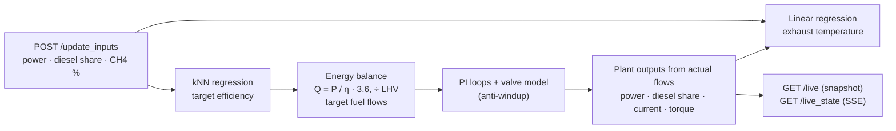

# Dual-Fuel Engine Digital Twin

A digital twin of a diesel/biogas generator set: ML models and an energy balance set the targets, PI loops drive the simulated fuel valves, and FastAPI streams the state.

[](#run-locally)
[](https://fastapi.tiangolo.com/)
[](#run-with-docker)
[](LICENSE)
[](https://kivanho.github.io/#twin)

<picture>
  <source media="(prefers-color-scheme: dark)" srcset="docs/twin_overview_dark.png">
  
</picture>

<sub>Both panels come from the synthetic engine map shipped here (`python -m scripts.make_figures`), not from lab data.</sub>

## What it is

The genset is a 2.2 L four-cylinder diesel at 1500 rpm driving a three-phase 400 V alternator, converted to dual-fuel operation. Its ratings are 16.5 kVA / 13.2 kWe prime and 18 kVA / 14.4 kWe standby. You set the operating point: electrical power, diesel energy share and the methane content of the gas. The twin then:

- predicts the target electrical efficiency and exhaust temperature,
- works out the diesel and CH4 mass flows from an energy balance,
- moves two simulated fuel valves towards those flows, one step per second,
- computes power, current, torque and exhaust temperature from the actual flows.

This was a master's project at IMT Atlantique (Feb–Jun 2025) in a team of three; I led the project and did the main implementation. This repository is a cleaned re-publication of that code (2026). The original repository stays private because it contains the lab data.

## How it works



| Step | Model |
|------|-------|
| Efficiency | k-nearest neighbours, k = 10, Manhattan distance, on power and CH4 share (standardised) |
| Exhaust temperature | Linear regression on power, CH4 share and diesel energy share |
| Fuel flows | Fuel energy Q = P / η, split by diesel energy share, divided by LHV (diesel 42.7 MJ/kg, CH4 50.03 MJ/kg) |
| Control | PI controller per fuel line on a first-order valve (T = 2 s), gains chosen so the closed loop has a 0.8 s time constant; command clamped to the valve range, integrator frozen while saturated |
| Electrical side | I = P / (√3 · U · cos φ) at 400 V, cos φ 0.8; shaft torque T = P / (η_genset · ω) with η_genset = 14.4 / 18.0 from the datasheet |

## Results

| | Lab data (original project) | Synthetic map (this repo) |
|---|---|---|
| Efficiency, kNN, R² on a 20 % hold-out | 0.93 | 0.94 |
| Exhaust temperature, linear, R² | 0.96 (training fit) | 0.99 (hold-out) |
| Settling, within 2 % after a set-point change | under 5 s | 2–4 s; about 5 s from standstill |

The synthetic exhaust temperature is itself a near-linear formula, so its 0.99 says nothing about real engines. The lab scores can't be reproduced here because the lab data are not published.

## About the data

The original models were trained on lab measurements from the test bench, which are not public. This repository ships a **synthetic engine map** (`app/synthetic_data.py`) with the same columns and physically plausible trends, so everything runs end to end.

At 100 % CH4 and 30 % diesel energy share, the synthetic efficiency and exhaust-temperature curves are anchored to the diesel-only genset datasheet: efficiency is within 1 percentage point at 50, 75 and 100 % load. Treating the dual-fuel engine like the diesel original at that point is an assumption. The dual-fuel effects on top are illustrative, not measurements of the real engine.

To train on your own measurements, point `ENGINE_MAP_CSV` at a CSV with the columns listed in `app/synthetic_data.py`.

## Run with Docker

```bash
docker build -t dual-fuel-twin .
docker run --rm -p 8000:8000 dual-fuel-twin
```

Interactive API docs: http://localhost:8000/docs

Set an operating point (12 kW, 20 % diesel energy share, 80 vol-% CH4):

```bash
curl -X POST http://localhost:8000/update_inputs \
  -H "Content-Type: application/json" \
  -d '{"power_output": 12, "diesel_energy_share": 20, "methane_percentage": 80}'
```

Read the state once, stream it as Server-Sent Events, or reset:

```bash
curl http://localhost:8000/live
curl -N "http://localhost:8000/live_state?max_events=5"
curl -X POST http://localhost:8000/reset
```

Ten seconds after a start from standstill, the state looks like this:

```json
{
  "time_s": 10.0,
  "input":  {"power": 12.0, "des_percent": 20.0, "ch4_percent": 80.0},
  "target": {"efficiency": 0.289, "diesel_mass_flow_kg_h": 0.701, "ch4_mass_flow_kg_h": 2.394, "exhaust_temp": 319.8},
  "actual": {"power": 11.99, "diesel_mass_flow_kg_h": 0.701, "ch4_mass_flow_kg_h": 2.39, "diesel_energy_share": 20.0,
             "co2_in_fuel_gas_kg_h": 1.639, "exhaust_temp": 319.5, "current": 21.6, "torque": 95.4}
}
```

Inputs must lie inside the engine map: 2–14.4 kW, 10–60 % diesel energy share and 55–100 vol-% CH4. Anything outside is rejected with HTTP 422 rather than extrapolated.

## Run locally

Python 3.11 or 3.12:

```bash
python3.12 -m venv .venv && source .venv/bin/activate
pip install -r requirements-dev.txt
uvicorn app.main:app --reload     # API on http://localhost:8000
pytest                            # 19 tests
python -m scripts.train_models    # hold-out scores on the engine map
python -m scripts.make_figures    # regenerate docs/*.png
```

## Repository layout

| Path | Role |
|------|------|
| `app/main.py` | FastAPI app, background simulation loop, endpoints |
| `app/simulation_service.py` | Models, flow loops and state; one `step()` per second; JSON output |
| `app/simulation_core.py` | One step: predict, balance, regulate, derive outputs from the actual flows |
| `app/knnr_model.py` | kNN efficiency model with a hold-out score |
| `app/exhaust_temp_model.py` | Linear exhaust-temperature model |
| `app/calculate_massflows.py` | Energy balance from power and efficiency to fuel mass flows |
| `app/regulator.py` | PI controller on a first-order valve model, with anti-windup |
| `app/engine_specs.py` | Genset ratings from the datasheet |
| `app/synthetic_data.py` | Synthetic engine map, operating range, or your own CSV |
| `scripts/` | Model scores and README figures |
| `tests/` | Energy balance, electrical formulas, control loop, API |

## Limitations

- **Inputs are set by hand** through `/update_inputs`. A live connection to the engine's sensors was planned as future work and is not part of this project. The genset's control panel exposes a CAN data link that such a connection could read from.
- The kNN model only uses power and CH4 share. Diesel energy share enters through the energy balance and the exhaust-temperature model.
- During transients, the electrical efficiency is held at the target operating point's value; power follows the actual fuel energy. Power is limited to the 14.4 kWe standby rating.
- The torque formula uses a constant shaft-to-terminal efficiency of 0.8. At the standby rating it gives 115 Nm, against 114 Nm from the datasheet's mean effective pressure.
- CO2 in the fuel gas comes from the CH4 volume share of the CH4/CO2 mix (molar masses 16.04 and 44.01 g/mol). It is the CO2 fed in with the biogas, not the exhaust emission.

## License

MIT, see [LICENSE](LICENSE).
